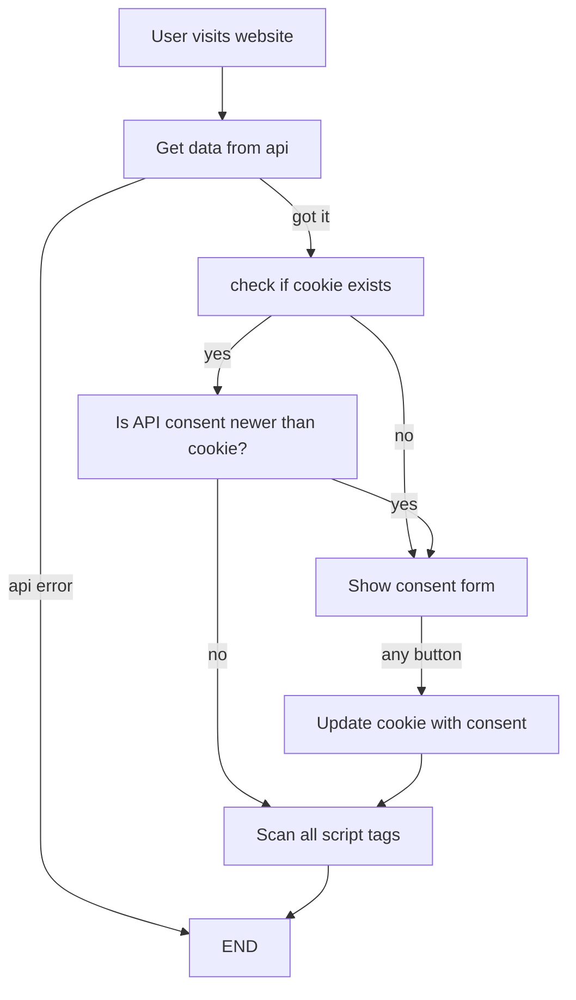
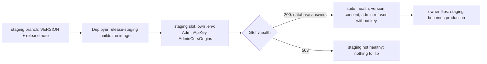

# 🍪 Cookie Consent Component


A GDPR-compliant cookie consent web component that **actually blocks scripts** until consent is granted.

## 🚀 [Live Demo](https://glideroggan.github.io/cookieConsent/)

Try the interactive demo to see how scripts are truly blocked and enabled based on user consent.

## ✨ Features

- **🚫 True Script Blocking** - Scripts with `type="text/plain"` are completely blocked by the browser
- **⚡ Zero Dependencies** - Pure vanilla TypeScript web component  
- **🎨 Fully Customizable** - Style and configure to match your brand
- **📱 Mobile Friendly** - Responsive design that works on all devices
- **🔧 Easy Integration** - Works with Google Analytics, Facebook Pixel, and any tracking script
- **🌐 API Integration** - Optional backend API for centralized consent management

# Usage
```html
<script type="module" src="https://unpkg.com/@glideroggan/cookie-consent/dist/cookie-consent.esm.js"></script>
```
- will create its own element `<cookie-consent></cookie-consent>`
- all script tags that should be blocked, should have their type set to `text/plain`, and the `data-consent` attribute set to the catorgory of the script, e.g. `data-consent="analytics"`.

# How it works
The component will check if a cookie exists with the name `cookie-consent`. If it does, it will check if the API consent is newer than the cookie. If it is, it will show the consent form. If the cookie does not exist, it will also show the consent form.

When the user accepts/declines, it will:
1. Update the cookie with the consent preferences
2. Automatically scan all script tags with `data-consent` attributes
3. Enable scripts by replacing `type="text/plain"` with executable script tags
4. Browser immediately downloads and runs the newly enabled scripts
5. Emit a `scripts-enabled` event with details about enabled categories

**No page reload required!** Scripts are dynamically enabled when consent is given.

# Flowchart


# The consent API on Deployer staging slots
The API (`api/`, image `glideroggan/cookie-consent-api`) is built for Deployer's staging slots: production and staging
run the same image, each with its own environment.

| Endpoint | Answers |
|---|---|
| `GET /health` | 200 `{status, database, version}` only when a real query on the database works; 503 otherwise (also for an empty database file, which SQLite creates on open). Deployer's slot check and the suite use it. |
| `GET /version` | 200 `{version}`, the running version, never cached |

**Version.** `api/VERSION` is the one place: `api.csproj` reads its `<Version>` from it, and `deployer.staging.json`
names it as the `versionFile` the staging release reads. Bump it on the `staging` branch with the change and add
`release-notes/<version>.md` (1 to 3 lines, at most 300 characters, written by hand).

**Configuration per slot (environment, never code).**

| Setting | What it does |
|---|---|
| `AdminApiKey` | the admin key (`X-API-Key`); staging gets its own. In Development an empty key means every admin request is refused; outside Development it stops the start (below). |
| `AdminCorsOrigins` | comma-separated admin origins; when set it **replaces** `AllowedAdminOrigins` from appsettings, so staging inherits none of production's. Set but empty: no admin origin. |
| `AllowedAdminOrigins__0`, `__1`, ... | the older list; environment entries only override appsettings entries by index |
| `ConnectionStrings__DefaultConnection` | the SQLite file (`/app/data/consent.db` in the image) |

Outside Development the app refuses to start (a critical log line and the exception, both naming `AdminApiKey`, never
its value; non-zero exit) while `AdminApiKey` is missing, empty or one of the example keys this repository shows
(`AdminKeyRules.PublicExampleValues`); set the slot's own random key in its environment.

**Tests.** `dotnet test cookieConsent.sln` runs `api.Tests` (the real app on a temp SQLite file per test: `/health`
200 and 503, `/version`, the admin key and CORS origins). The suite Deployer runs after a staging deploy is
`tests/apps/cookie-consent.ps1` in the Deployer repo (a copy is kept in `deployer-suite/`); it is read-only and needs no key.



# BUGS
- removing a category and then switching over to global config, then the version is still lagging behind

# FEATURES
## implement on nyviken.se
- change name of the demo admin api
- add another admin api for nyviken.se
- add the admin web page for nyviken.se
- add the login component for the admin web page
- document the cookies we use on nyviken.se

# TODO

- we should clean up the workspace
- we should do some sanity checks on the api
  - throttle number of post and put requests
  - ✔️restrict the inputs to not create overly long strings
  - ✔️restrict the maximum number of categories and cookies
- need middleware for reporting cookies being created on server sides
- we need some way to show the entire list of the cookies
- more languages
- add the fallback categories in the slot of the element, so that users can specify fallback categories in the consent form
- Look into what we need to do to cover all the scripts in a page, because "document.querySelectorAll('script[data-consent]')" will not cover all cases